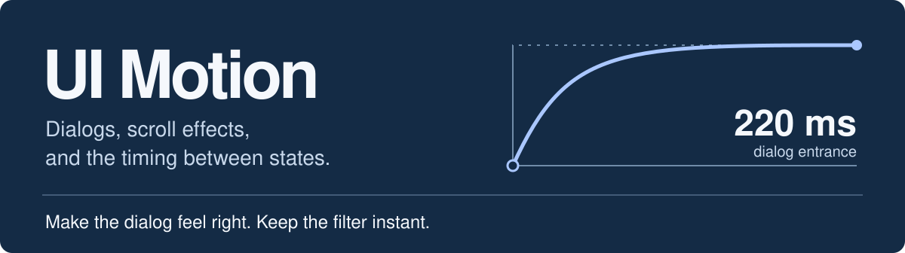

# UI Motion

**A UI animation skill for Claude Code, Cursor, and Codex.**

A dialog should open smoothly. A filter you use all day should respond immediately.
UI Motion gives your coding agent rules for making those calls, plus React examples
for the details that are easy to miss: focus, cancellation, resizing, and reduced motion.

[Install](#install) · [Try it](#try-it-on-your-ui) · [React examples](#react-animation-examples) · [Read the skill](skills/ui-motion/SKILL.md)

## Install

```sh
npx github:adnanrahim110/ui-motion-skill
```

Choose global or project installation, select your agents, and review the files.
The wizard suggests agents it finds on your machine; you can change that selection.
You need **Node.js 18+ and Git**.

Already use the [Skills CLI](https://github.com/vercel-labs/skills)?

```sh
npx skills add adnanrahim110/ui-motion-skill --skill ui-motion -g
```

The bundled installer supports **Claude Code, Cursor, Codex, Antigravity, Windsurf,
GitHub Copilot, Gemini CLI, Cline, and Roo Code**.

[Installation options](docs/installation.md) cover project scope, specific agents,
dry runs, pnpm, Bun, updates, and removal. [Compatibility notes](docs/compatibility.md)
list paths and explain shared skill directories.

## Try it on your UI

After installation, ask your agent to use `ui-motion`. In Claude Code you can write
`/ui-motion`; in Codex, `$ui-motion`. Refresh the agent's skill list if it hasn't
picked up the new files.

**Fix an interaction that feels slow**

> Use ui-motion to review this filter panel. I switch filters dozens of times a day.
> Make selection immediate, keep keyboard focus visible, and remove any motion
> that makes me wait. Explain the changes before editing.

**Build a dialog with changing content**

> Use ui-motion for an upload dialog with review and confirmation steps. Keep one
> dialog open, preserve the form when I go back, and cancel verification if I close
> it. Handle reduced motion too.

**Work on scroll animation**

> Use ui-motion to add reading progress to this long guide. Keep every section
> readable without animation and update the progress when the content resizes.

## What changes in the agent's work

The skill asks the agent to decide whether motion helps before choosing an effect.
For an animation worth keeping, it specifies the trigger, timing, easing, interruption,
and reduced-motion behavior before writing code.

| Interaction | What the skill asks for |
| --- | --- |
| Tabs, filters, repeated commands | Immediate state changes. Keep the control responsive. |
| Dialogs and multi-step forms | A stable container, deliberate focus, and a quick exit. |
| Loading and verification | Real request state, cancellation, and a way to retry. |
| Scroll effects and parallax | A readable page at rest, bounded movement, and cleanup. |
| Hover and cursor effects | A fixed hit target and checks for the actual input device. |

It works with the project's animation stack. The references cover CSS transitions,
easing curves, spring physics, scroll timelines, FLIP, and view transitions. They also
explain when Motion or GSAP is useful. Existing project rules still apply.

## React animation examples

Five components are included as source files. Each handles one interaction and
accepts your content or application callbacks.

| Example | Details it handles |
| --- | --- |
| [Progressive dialog](skills/ui-motion/assets/react/progressive-dialog.tsx) | Native dialog behavior, step focus, changing height, return focus, and an inline fallback. |
| [Verification code](skills/ui-motion/assets/react/verification-code.tsx) | Paste and autofill, server verification, duplicate submissions, cancellation, and retry. |
| [Magnetic button](skills/ui-motion/assets/react/magnetic-button.tsx) | Small pointer movement inside a stationary button, with touch and reduced-motion handling. |
| [Scroll story](skills/ui-motion/assets/react/scroll-story.tsx) | Your section content, working anchor links, and a scroll progress rail. |
| [Reading progress](skills/ui-motion/assets/react/scroll-progress.tsx) | Document progress that updates after layout changes. |

These use **React, TypeScript, Tailwind CSS, and Motion for React** (formerly
[Framer Motion](https://motion.dev/docs/react)). Copy the component you need and
follow its [integration guide](skills/ui-motion/references/05-code-recipes.md).
The motion guidance also applies to projects using other frameworks.

## Read the reasoning

Start with [SKILL.md](skills/ui-motion/SKILL.md). The agent loads the relevant guide
for the task; it doesn't need to read the entire reference set every time.

<details>
<summary>Browse the seven guides</summary>

- [When animation helps](skills/ui-motion/references/01-philosophy-and-science.md)
- [Timing, easing, and springs](skills/ui-motion/references/02-timing-easing-and-springs.md)
- [Microinteractions, dialogs, and loading states](skills/ui-motion/references/03-microinteractions-and-components.md)
- [Scroll, parallax, and pointer effects](skills/ui-motion/references/04-scroll-parallax-and-cursor.md)
- [React component integration](skills/ui-motion/references/05-code-recipes.md)
- [Sources and attribution](skills/ui-motion/references/06-sources.md)
- [Checks and evaluation scenarios](skills/ui-motion/references/07-validation.md)

</details>

The original brief drew on Manu Arora's approach to animation. The source notes
also credit Emil Kowalski, Rauno Freiberg, Benji Taylor, Apple, W3C, and Chrome.
Timing presets are documented as choices you can adjust, with research claims
linked to their sources.

## Contributing

Bring a specific interaction: what the user does, what feels wrong, and how the
change helps. Include checks for the behavior you change.

<details>
<summary>Run the local checks</summary>

Use Node.js 22.18+ or 24.11+ for development. The installer itself runs on Node.js 18+.

```sh
npm ci
npm run check
npm run lint
npm run typecheck
npm test
npm run test:package
```

These check source files, links, types, installer behavior, React behavior in jsdom,
and installation from the packed package. Browser checks stay with the consuming
application; these commands don't launch a browser.

Repository metadata and the evidence behind its search terms are in the
[discoverability notes](docs/discoverability.md).

</details>

[Report an issue](https://github.com/adnanrahim110/ui-motion-skill/issues) ·
[MIT license](LICENSE) · Built by [Adnan Rahim](https://github.com/adnanrahim110)
